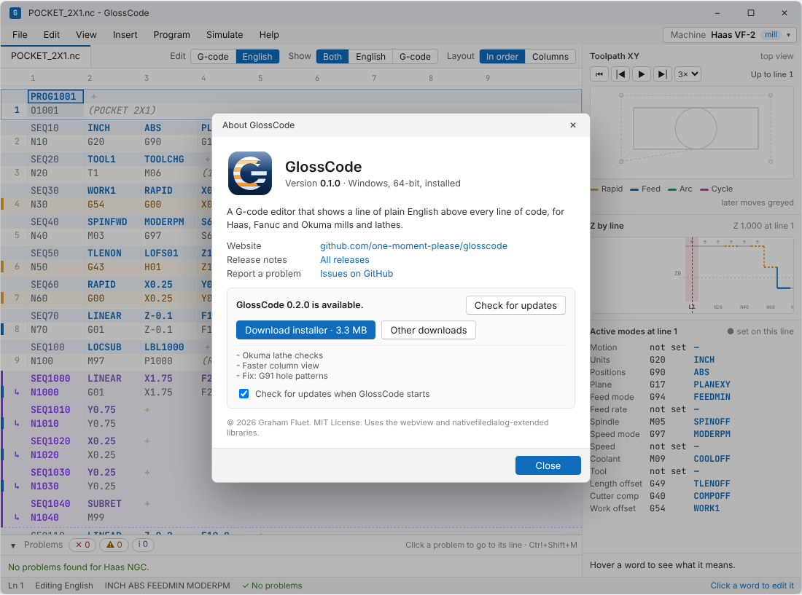

# Releasing

How GlossCode versions are numbered, what each release contains, and how the app finds updates.

## Version number

The version lives in one place: the [`VERSION`](../VERSION) file at the repository root, in `MAJOR.MINOR.PATCH` form (`0.1.0`). A pre-release adds a suffix (`0.2.0-beta.1`).

- The build compiles it into the program, where Help › About shows it and the update check compares against it.
- `node scripts/sync-mockup-data.mjs` copies it into the mockup's About window.
- Each release is a Git tag named `v` plus the version (`v0.1.0`), and a GitHub Release made from that tag.

While the version starts with `0.`, file formats (machine definitions, library files, settings) may still change between releases.

## Release files

Every release has the same files, so the update check can pick the right one by its name.

| File | What it is |
|---|---|
| `GlossCode-<version>-windows-x64-setup.exe` | Windows installer. Installs for the current user without administrator rights, adds a Start menu entry and an uninstaller. |
| `GlossCode-<version>-windows-x64-portable.zip` | Windows portable copy: `GlossCode.exe` plus an empty `portable` file, so settings stay in `GlossCode-data` beside it. |
| `GlossCode-<version>-linux-amd64.deb` | Debian and Ubuntu package. Depends on the distribution's GTK 3 and WebKitGTK packages. |
| `GlossCode-<version>-linux-x86_64.rpm` | Fedora and openSUSE package, with the same dependencies. |
| `GlossCode-<version>-linux-x86_64-portable.tar.gz` | Linux portable copy, same layout as the Windows zip. Needs GTK 3 and WebKitGTK installed. |
| `SHA256SUMS.txt` | SHA-256 checksum of every file above. |

The release notes are the release's description on GitHub, and the About window shows them.

## Checking for updates

Help › About GlossCode has a **Check for updates** button, and a setting (on by default) to check once at startup.

1. GlossCode requests `https://api.github.com/repos/one-moment-please/glosscode/releases/latest`. This returns the newest published release that isn't a draft or pre-release. No account or token is needed, and nothing is sent except the request itself.
2. It compares the release's tag with its own version. If the release is newer, it shows the version, the release notes and a download button.
3. An installed copy offers the installer; a portable copy offers the portable archive. **Other downloads** opens the release page.
4. The download goes to the user's Downloads folder. GlossCode checks it against `SHA256SUMS.txt` from the same release and refuses a file that doesn't match. On Windows it then offers to close and run the installer. On Linux it opens the folder, since installing a package needs the system's package tool.

If GitHub can't be reached, or limits requests (60 an hour per network address without a token), the window says so and nothing else happens. The startup check stays silent unless there is an update.

The platform file gets one more function for this: download a URL to a file (WinHTTP on Windows, libcurl on Linux). The request to the Releases API can go through the webview, since it is plain HTTPS.

## What a first release needs

The UI, data, icons, the packaging plan, the core and the program exist. Before binaries can be published, these are still needed, roughly in this order:

| | Item | Status |
|---|---|---|
| ✓ | UI design (the mockup), dictionary, rules, built-in library, sample programs | Done; the mockup's UI still has to be separated from its built-in sample data |
| ✓ | App icon (`assets/logo/glosscode.ico`, PNGs) | Done |
| ✓ | License (MIT) | Done |
| ✓ | Where user files go, portable mode, single executable plan ([architecture.md](architecture.md#packaging)) | Written down |
| ✓ | Version number and release file names | This page |
| ✓ | **Core in C**: parser, mode tracker, translator, checks, dictionary loader | Done (`src/core/`), checked against the mockup by `test_golden` |
| – | **Platform files** `platform_win32.c` and `platform_posix.c` | Done except the download function and file watching |
| – | **Webview shell**: window, bindings between the UI and the core, embedded UI and data | Done for Open, Save, Save As and About; the UI still draws with its own copy of the logic and the mockup's sample data |
| ✓ | **Build script** (CMake) for MinGW-w64 on Windows and gcc on Linux, with webview and nativefiledialog-extended added as pinned dependencies | Done, with CI on Windows and Linux ([building.md](building.md)) |
| ✓ | **Windows resource file**: icon, version info shown in the file's Properties | Done (`src/app/glosscode.rc.in`) |
| ✗ | **Windows installer script** (Inno Setup): per-user install, Start menu entry, uninstaller, optional `.nc` file association | Not started |
| ✗ | **Linux packages**: `.desktop` file and icon, `.deb` and `.rpm` (nFPM builds both from one file) | Not started |
| ✗ | **Release workflow** (GitHub Actions): on a `v*` tag, build on Windows and Linux, package, write `SHA256SUMS.txt`, and create a draft release | Not started |
| – | **Third-party notices** for webview (MIT) and nativefiledialog-extended (zlib), shipped with every release | Written (`THIRD_PARTY_NOTICES.md`); not packaged yet |
| ✗ | `CHANGELOG.md` | Not started |
| – | **Code signing** for the Windows .exe and installer | Optional for a first release; see below |

### Code signing

Unsigned Windows programs still run, but SmartScreen shows "Windows protected your PC" until the file builds a download reputation, and the user has to click **More info › Run anyway**. Signing removes most of that. The options are a code signing certificate from a certificate authority, or a cloud signing service such as Azure Trusted Signing; both cost a yearly fee and need identity verification. A first release can ship unsigned with a note in the release description explaining the warning, and add signing later without changing anything else.

Linux packages are not usually signed for direct downloads; `SHA256SUMS.txt` covers integrity.

## Making a release

Once the workflow exists:

1. Update `VERSION` and `CHANGELOG.md`, run `node scripts/sync-mockup-data.mjs`, and merge.
2. Tag the merge commit: `git tag v0.1.0 && git push origin v0.1.0`.
3. The release workflow builds everything and creates a **draft** release with the files attached.
4. Install and run each file on a clean Windows and Linux computer, paste the changelog section into the release notes, and publish. Publishing is what makes the update check see it.
