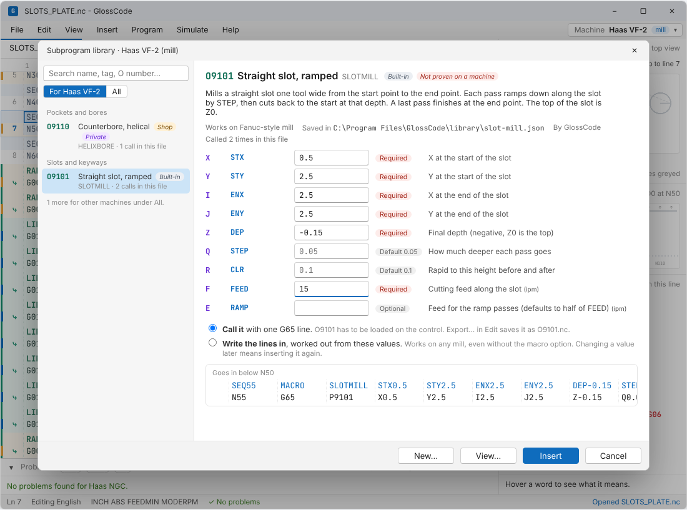
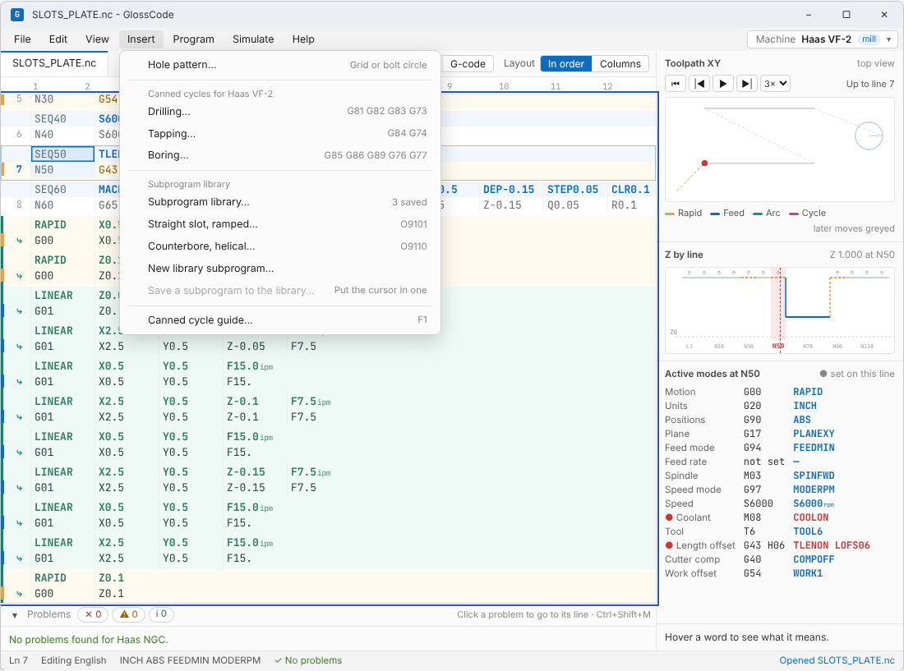
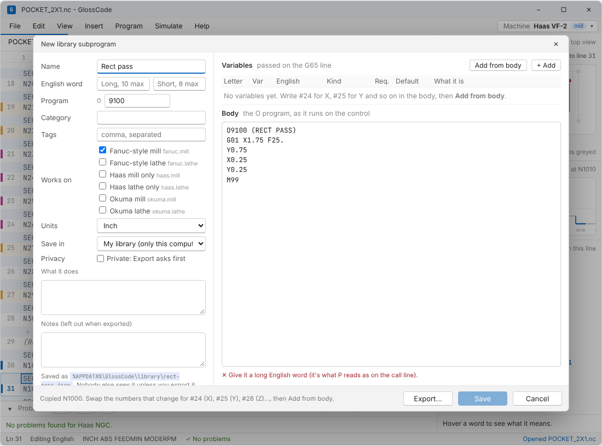
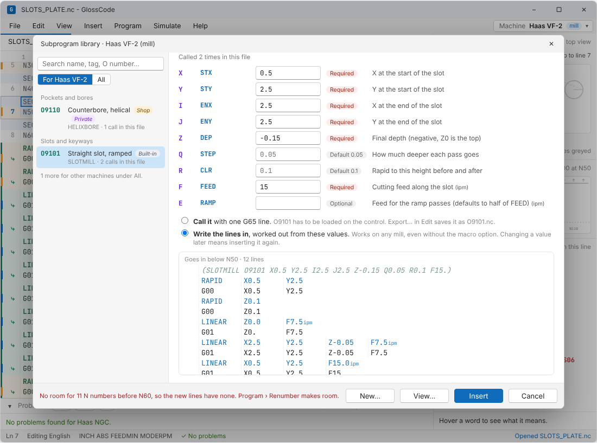
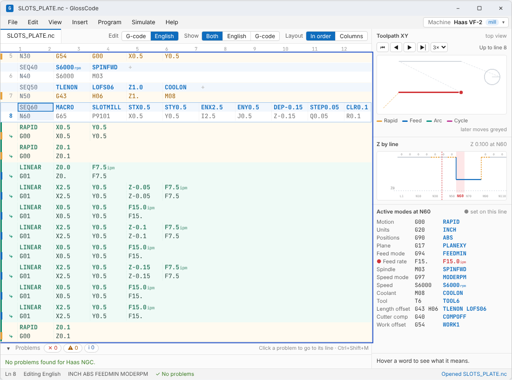
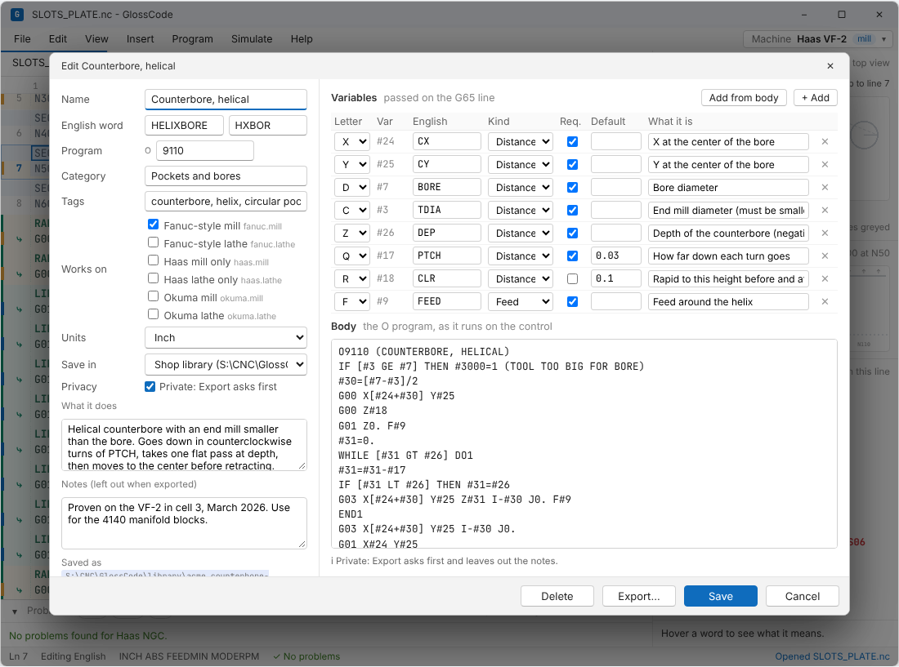

# Subprogram library

> **Status: in the mockup.** Insert › Subprogram library… works in [the mockup](mockup/index.html). Try it on **SLOTS_PLATE.nc**.

Some operations get reused across many programs, and only a few numbers change between parts. A slotting routine is a good example: the moves are the same every time, and only the slot's position, depth and feed change. The subprogram library keeps routines like that in one place. Each one has named variables. You can find it from the Insert menu, fill in the values for this part, and put it in the program.



## Summary

- **A library subprogram is one file.** It holds the O program the control runs (the body), a list of variables with English names, and a name, category and tags so it can be found.
- **Variables are passed the standard way.** Each variable is a letter on a `G65` line, and the body reads it as a `#` variable (X is `#24`, Y is `#25`, and so on). That's Fanuc Custom Macro B, which Haas also uses, so the body is a normal macro program that runs on the control as written.
- **There are two ways to insert one:**
  - **Call it**: one line, `G65 P9101 X0.5 Y0.5 I2.5 J0.5 Z-0.15 F15.`. The O program has to be loaded on the control.
  - **Write the lines in**: GlossCode works out the moves from the values and inserts plain G-code. This works on any control, including ones without the macro option, but changing a value later means inserting it again.
- **Calls read in English.** On a call line, `P9101` reads `SLOTMILL` and each value reads by its variable's name (`DEP-0.15`, `FEED15.0`ipm). **▸ show O9101** lists the lines the call runs, in green, under the call. The toolpath preview and the Z timeline follow them.
- **Finding and managing** happens in the same window: search, filter to this machine, and New, Edit, Make my own copy, Delete and Export. Insert › Save N1000 to the library… turns a subprogram that's already in the program into a library one.
- **Storage follows the machine definition files.** Built-in, shop and personal folders, each with a `library` folder. Private or shared is decided by where the file lives, and `"private": true` makes Export ask first (see [machine-definitions.md](machine-definitions.md#where-files-live)).

## Using it

### Insert menu

The Insert menu has a **Subprogram library** group under the canned cycles:



- **Subprogram library…** opens the window.
- The library subprograms for this machine are listed directly (up to five, most-used in this file first). Each opens the window with that one selected.
- **New library subprogram…** opens the editor with a blank one.
- **Save N1000 to the library…** is enabled while the cursor is in a local subprogram (an `M97` block like `N1000 … M99`) or on the line that calls one. It copies the block into a new library subprogram, and you swap the numbers that change for variables.



### The library window

- **Search** matches the name, English word, category, tags, description, author, O number (`9101` or `O9101`) and variable names.
- **For this machine / All.** The list normally shows only subprograms written for the selected machine. **All** shows the rest, greyed, with the machines they're for.
- Each entry shows its folder (**Built-in**, **Shop** or **Mine**), **Private** if it's marked private, and how many times this file calls it.
- The right side shows what it does, where its file is, a box for each variable (required ones are marked; a default shows in grey and is used if the box is left empty), the two ways to insert it, and a preview of the lines with their English.
- A distance or feed typed without a decimal point gets one (`1` becomes `1.`), following the display rules.
- **Call it** is turned off, with the reason shown, when the subprogram is for a different control or the machine has no macro option. **Write the lines in** is turned off only when it's for a different kind of machine (a lathe routine on a mill).



When the lines are written in, a comment line goes first with the values used, such as `(SLOTMILL O9101 X0.5 Y2.5 I2.5 J2.5 Z-0.15 Q0.05 R0.1 F15.)`, so you can tell later where the lines came from and insert it again with the same values. The lines get N numbers when Auto N is on and there's room, the same way the hole pattern tool numbers its lines.

### In the program



- `G65` reads **MACRO**, and `P9101` reads the subprogram's English word (**SLOTMILL**). Each value reads by its variable's name. Hovering shows what each one is and which `#` variable it fills.
- **▸ show O9101** lists the lines the call runs, worked out from the values on that line, with a green bar and **⤷** in the margin. They're read-only: change a value on the call line, or edit the subprogram in the library. **Program › Show all subprograms** opens these too.
- The toolpath preview, simulation and Z timeline follow the call.
- A `G65 P` whose program isn't in any library folder gets **O9999 isn't in the library**. That's fine if it's on the control; GlossCode just can't show what it does.
- The checks treat a `G65` line as a call, not a move, so its X, Y and Z values don't count as a rapid or feed. After a call, the tool position is unknown until the next absolute move.

### The editor



- **Name**, **English word** (long, 10 letters at most; short, 8 at most), **program number**, **category**, **tags**, which machines it **works on**, **units**, which folder it's **saved in**, and **private**.
- **Variables**: letter (the `#` number is shown next to it), English name, kind (distance, feed, speed, count, angle, seconds), required, default, and what it is. **Add from body** adds a variable for each `#1`–`#26` the body reads that isn't one yet.
- **Body**: the O program exactly as it runs on the control.
- Problems show as you type. A save is blocked by missing names or English words, a letter used twice, or no machine ticked. Warnings cover an O number another library subprogram already uses, a `#` the body reads that isn't a variable (so it's always empty), a variable the body never reads, a body that doesn't start with its O number or doesn't end with M99, and a body that can't be written in (it uses something the reader below doesn't support). A built-in subprogram opens read-only, and **Make my own copy** saves an editable copy in your library with the next free O number.
- **Export…** writes the library file (`slot-mill.json`) for other GlossCode users, or just the body (`O9101.nc`) to load on the control. For a private one it asks first and leaves out `notes` and `shop`, the same as machine files.

## The file

One JSON file per subprogram. Examples: [`data/library/slot-mill.json`](../data/library/slot-mill.json) and [`data/library/groove-od.json`](../data/library/groove-od.json) (built in), and [`examples/counterbore-helical.json`](subprogram-library/examples/counterbore-helical.json) (a shop's private one).

```jsonc
{
  "glosscode": "subprogram/1",          // format version
  "id": "slot-mill",                    // unique across all folders; also the file name
  "name": "Straight slot, ramped",
  "word": { "long": "SLOTMILL", "short": "SLOT" },   // what P9101 reads as
  "program": 9101,                      // the O number it has on the control
  "category": "Slots and keyways",      // groups the list
  "tags": ["slot", "keyway", "ramp"],   // extra search words
  "machines": ["fanuc.mill"],           // machine definition ids; anything that extends one counts
  "units": "inch",                      // units of the defaults and the body's fixed numbers
  "private": false,
  "verified": false,                    // true once it's been proven on a machine
  "author": "GlossCode",
  "about": "Mills a straight slot one tool wide…",
  "args": [
    { "letter": "X", "name": "STX",  "kind": "distance", "required": true, "desc": "X at the start of the slot" },
    { "letter": "Q", "name": "STEP", "kind": "distance", "required": true, "desc": "How much deeper each pass goes",
      "default": { "inch": "0.05", "mm": "1.25" } },
    { "letter": "F", "name": "FEED", "kind": "feed",     "required": true, "desc": "Cutting feed along the slot" }
  ],
  "body": [
    "O9101 (STRAIGHT SLOT, RAMPED)",
    "G00 X#24 Y#25",
    "…",
    "M99"
  ],
  "notes": "",                          // left out when exported
  "shop": { }                           // left out when exported
}
```

### Variables

The letter is the word on the `G65` line, and the body reads the matching variable. This is the standard Fanuc argument list (argument specification I), which Haas uses too:

| Letter | A | B | C | I | J | K | D | E | F | H | M | Q | R | S | T | U | V | W | X | Y | Z |
|---|---|---|---|---|---|---|---|---|---|---|---|---|---|---|---|---|---|---|---|---|---|
| Variable | #1 | #2 | #3 | #4 | #5 | #6 | #7 | #8 | #9 | #11 | #13 | #17 | #18 | #19 | #20 | #21 | #22 | #23 | #24 | #25 | #26 |

G, L, N, O and P can't be variables (P is the program number and L is the repeat count). The body can use `#30` to `#33` as scratch variables, since the call clears them.

- **English names** are 1 to 5 letters or digits. Four or fewer always fit a column with the value after them (`DEP-0.15`, `STEP0.05`). The editor warns at five.
- **Kind** decides how the value is shown and typed: distances and feeds always get a decimal point, a feed shows its unit (`FEED15.0`ipm), and a count must be a whole number.
- **Defaults** can be one value or one per unit (`{ "inch": "0.1", "mm": "2.5" }`). GlossCode writes the default into the call line when the box is left empty, so every call says exactly what it passes, and the body doesn't have to handle empty variables. A body can still handle them (`IF [#8 EQ #0] THEN #8=#9/2` in the slot example) for calls typed by hand.
- Avoid **T**, **S** and **H** as variable letters unless the value really is a tool, speed or offset. The checks read those letters on any line.

### Which machines it works on

`machines` lists machine definition ids, matched the same way `extends` works in [machine definitions](machine-definitions.md#layers): a subprogram for `fanuc.mill` works on `haas.ngc.mill` (which extends it) and on any shop machine built on either. A subprogram that uses a control's own codes lists that control (`haas` for one that uses `M97`).

Calling needs the machine's **macro option** (`machine.options.macro` in the definition file; **Custom macro** in the mockup's Machine profiles window). Many controls include it; on others it's a paid option, and some older ones don't have it at all. A machine without it, like the 1990 Fanuc 0-MC sample profile, only gets **Write the lines in**.

### Where files live

The same three folders as machine definition files, each with a `library` folder beside `machines`:

| Folder | Who writes it | Shared? |
|---|---|---|
| Built into the program (compiled into the .exe) | GlossCode releases | Built in, read-only |
| `<shop folder>\library` (the shop folder set in Settings, often a network path) | The shop | With everyone who points at that folder |
| `%APPDATA%\GlossCode\library` (`~/.config/glosscode/library` on Linux) | The user | No |

- Nothing in the shop or personal folder leaves the computer or network unless someone exports it.
- Ids are unique across the three folders. A shop or personal file with a built-in file's id replaces it, and the window marks it **modified built-in**. **Make my own copy** gives the copy a new id, so the built-in one stays available.
- **O numbers** should be unique too, since the control only has one O9101. The editor warns when two library subprograms share one, and the window picks the one written for the selected machine. Many shops keep reusable macros in the O9000s; on Fanuc a parameter can protect that range from editing. Check the control's manual before relying on that.

## Writing the lines in

To write the lines in, and to show and preview a call, GlossCode runs the body with the values, the way the control would. It understands a deliberately small part of the macro language:

- `#n` variables, with `#0` as empty; numbers; `+ - * /` and `[ ]`; `ABS SQRT SIN COS TAN ATAN ROUND FIX FUP` (angles in degrees)
- `EQ NE GT GE LT LE`, `AND`, `OR`
- `#n=…`, `IF [ … ] THEN #n=…`, `IF [ … ] GOTO n`, `GOTO n`, `WHILE [ … ] DOn` … `ENDn`
- `#3000=n (MESSAGE)` stops with the alarm message, the way the control would
- Words whose value uses a variable or brackets (`X[#24+#30]`, `I-#30`, `Z#31`) are worked out and written with a decimal point, rounded to 0.0001 in or 0.001 mm. A word whose variable is empty is left out, as on the control.
- `O` lines are left out, and `M99` ends the body.

Anything else (system variables other than `#3000`, `#100`-range common variables carried in from outside, `SETVN`, `POPEN`/`DPRNT`, or another `G65` inside the body) means that subprogram can only be called. The window says so and turns off **Write the lines in**. A body that runs more than 20,000 lines or writes more than 2,000 is stopped as a probable endless loop.

This reader is also the start of the "macro programs checked by running them" item in the features list.

## Not done yet

- **Checks inside a call.** The checks don't yet walk into a library subprogram's lines with the modes active at the call, the way they do for M97 subprograms. The reader already produces those lines, so this is mostly plumbing in `checkProgram()`.
- **Save with the program.** When a program calls library subprograms, Save could list them and offer to write each `O9101.nc` next to the program, so they go to the control together.
- **Re-insert written-in lines.** The comment line written first holds the values. Selecting it could reopen the window with those values and replace the lines.
- **Subprograms without variables** could be called with `M98 P` instead of `G65 P`.
- **Okuma.** OSP passes values with `CALL O1234 PX=1.0` style variables and has its own syntax for the body. An Okuma library subprogram needs that call form and a reader for OSP User Task statements, checked against a manual first.
- **Lathe X as diameter** is handled by the body (the groove example works in diameters). A `diameter` kind for variables would let the window say so.

## Examples

| File | Folder | What it does |
|---|---|---|
| [`data/library/slot-mill.json`](../data/library/slot-mill.json) | Built-in | Straight slot one tool wide: ramps down along the slot each pass, cuts back at depth, then finishes to the end |
| [`data/library/groove-od.json`](../data/library/groove-od.json) | Built-in | OD groove on a lathe, pecking in X to break the chip, with a dwell at the bottom |
| [`examples/counterbore-helical.json`](subprogram-library/examples/counterbore-helical.json) | Shop, private | Helical counterbore: turns down by a pitch, a flat pass at depth, then back to the center. Alarms if the tool is bigger than the bore |
| [`examples/SLOTS_PLATE.nc`](../examples/SLOTS_PLATE.nc) | Program | Calls the slot twice and the counterbore once |

The example bodies haven't been run on a machine yet (`"verified": false` on the built-in ones; the shop example's `true` is part of the example). Dry run them above the part before trusting them.
